# ⚔️ Ascension: 12 Epochs (Восхождение: 12 Эпох)

Хардкорный экспертный RPG-техномагический модпак для **Minecraft 1.20.1 Forge (47.4.28)**.

> Главная концепция: **Полный отказ от унылого копания шахт (strip-mining)**. Всё развитие построено на строгой линейной прогрессии сквозь 12 эпох, где доступ к технологиям, магии и ресурсам открывается исключительно через победу над боссами, экспедиции в опасные измерения, сбор трофеев и компактную высокотехнологичную автоматизацию.

---

## 📜 12 Эпох Прогрессии

Каждая эпоха заблокирована финальным трофеем предыдущей. Линейка квестов насчитывает **412 авторских заданий** с подробными описаниями, лором и подсказками на русском языке.

```mermaid
flowchart TD
    E1["Эпоха 1: Пробуждение в Диких Землях<br/><i>(Born in Chaos & Простое выживание)</i>"] -->|Сердце Темного Вихря| E2["Эпоха 2: Глубинные Кошмары<br/><i>(Deeper and Darker & Скалк-ресурсы)</i>"]
    E2 -->|Сердце Стража / Незерит| E3["Эпоха 3: Адское Пламя и Древние Алтари<br/><i>(Nether, Blood Magic I)</i>"]
    E3 -->|Кровавый Шар Магистра| E4["Эпоха 4: Природные Чары Арканы<br/><i>(Ars Nouveau)</i>"]
    E4 -->|Дикий Рог Призывателя| E5["Эпоха 5: Мистический Сад Ботании<br/><i>(Botania)</i>"]
    E5 -->|Реликвия Гайи| E6["Эпоха 6: Небесный Архипелаг Эфира<br/><i>(The Aether)</i>"]
    E6 -->|Солнечный Диск Сансана| E7["Эпоха 7: Холодное Солнце и Пылающие Небеса<br/><i>(Blue Skies: Everbright & Everdawn)</i>"]
    E7 -->|Звездное Ядро Алхимика| E8["Эпоха 8: Гниющие Земли Андергардена<br/><i>(The Undergarden)</i>"]
    E8 -->|Забытый Глаз Катакомб| E9["Эпоха 9: Титаны Катаклизма и Древние Руины<br/><i>(L_Ender's Cataclysm)</i>"]
    E9 -->|Инфернальное Сердце Незера| E10["Эпоха 10: Память о Плоти и Цифровой Разум<br/><i>(Hostile Neural Networks & AE2)</i>"]
    E10 -->|Квантовая Процессорная Матрица| E11["Эпоха 11: Эссенция Мироздания и Алхимия<br/><i>(Mystical Agriculture & ProjectE)</i>"]
    E11 -->|Сфера Темной/Красной Материи| E12["Эпоха 12: Восхождение к Бесконечности<br/><i>(Avaritia: Финал Сборки)</i>"]
```



---

## ⚡ Особенности Сборки
1. **Без гринда в шахтах:** Все минералы, эссенции и ресурсы добываются через:
   - Боевые походы в данжи и башни.
   - Магические алтари (*Blood Magic*, *Ars Nouveau*, *Botania*).
   - Модели данных мобов и матричное клонирование дропа (*Hostile Neural Networks*).
   - Мистическое фермерство семян руд (*Mystical Agriculture*).
   - Конверсию материи и энергии EMC (*ProjectE*).
2. **412 авторских квестов (FTB Quests):**
   - Полная русская локализация.
   - Четкие гейткиперы между главами.
   - Пошаговые подсказки и объяснения механик каждого мода.
3. **Оптимизация:**
   - Подборка легковесных оптимизаторов (Embeddium, ModernFix, FerriteCore, Entity Culling и др.) для стабильного FPS.
   - Отсутствие тяжелых перегруженных генераторов мира — стабильный мир и быстрая загрузка чанков.

---

## 🛠️ Установка в лаунчерах (Prism / CurseForge / Modrinth)

### Вариант 1: Через Prism Launcher / Modrinth
1. Скачайте архив сборки или клонируйте репозиторий в папку экземпляров Prism Launcher:
   ```bash
   git clone https://github.com/Spectr0355/ascension-12-epochs.git "Ascension 12 Epochs"
   ```
2. Убедитесь, что установлены **Java 17** и версия Forge **47.4.28**.
3. Запустите игру.

### Список модов и хэшей
Полный список всех 72 модов с их размерами и контрольными суммами SHA1 доступен в файле [mod_list.txt](mod_list.txt).
